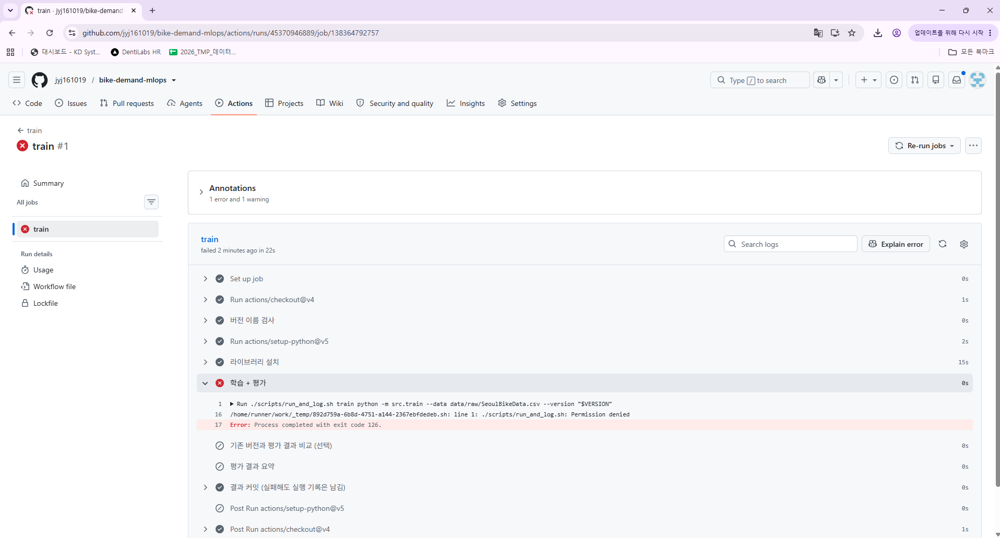
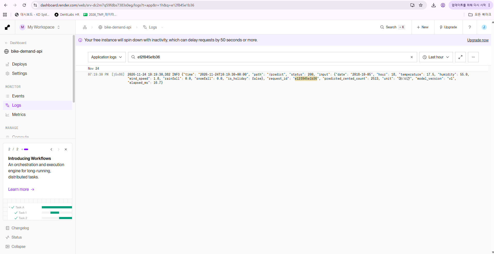

# 2. 클라우드 구성과 실행 기록

## 구성

```
[GitHub 저장소] ── Actions "train" (수동 실행) ──> [GitHub Actions 러너: ubuntu, python 3.11]
      ^                                               학습 + 평가 → models/<버전>/ , logs/
      └───────────── 결과를 커밋·푸시 ─────────────────┘
      │
      │ main 브랜치에 models/, app/, src/ 변경이 푸시되면 자동 배포
      v
[Render 웹 서비스 (Docker, free, singapore)]  ← MODEL_DIR=/work/models/<버전> (render.yaml)
      ^
      │ POST /predict
[사용자]   /   [GitHub Actions "smoke" : 정상·잘못된 입력 검사 → logs/ 커밋]
```

## 서비스 선택 이유

| 선택 | 이유 |
|---|---|
| GitHub Actions (학습, 검사) | 매번 새 클라우드 머신에서 실행되어 "새 환경에서 재실행" 이 자연스럽게 확인됨. 실행마다 기록 페이지가 남고, 결과를 저장소에 커밋해 코드·모델·기록이 한곳에 모임. 공개 저장소는 무료 |
| Render 웹 서비스 (서빙) | 이 서비스는 요청이 오면 바로 응답해야 하므로 상시 주소가 있는 서버가 필요. GitHub 저장소를 연결하면 푸시할 때 자동 배포되고, Dockerfile을 그대로 실행. 무료 인스턴스, 카드 등록 없음 |
| Docker | 학습(Actions)과 서비스(Render) 모두 python 3.11 + 같은 requirements.txt 를 사용해 모델 파일 호환 보장 |
| singapore 리전 | Render 리전 중 한국과 가장 가까움 |
| AWS/GCP 미사용 | 카드 등록이 필요하고, 이 규모(모델 수백 KB, 예측 1건 수 ms)에는 과함 |

## 설정

| 항목 | 값 | 위치 |
|---|---|---|
| 학습 환경 | ubuntu-latest, python 3.11, requirements.txt | `.github/workflows/train.yml` |
| 서비스 환경 | python:3.11-slim Docker, Render free 인스턴스 | `Dockerfile`, `render.yaml` |
| 서비스 모델 버전 | `MODEL_DIR=/work/models/v1` | `render.yaml` |
| 헬스 체크 | `/health` (모델 로드 실패 시 503 → 배포 실패 처리, 이전 배포 유지) | `render.yaml` |
| 자동 배포 범위 | app, src, models, Dockerfile, requirements.txt, render.yaml 변경 시만 | `render.yaml` buildFilter |
| 데이터 위치 | `data/raw/SeoulBikeData.csv` | 저장소 |
| 모델 위치 | `models/<버전>/` (저장소, Docker 이미지 안) | |
| 결과 위치 | 평가 `models/<버전>/`, 실행 기록 `logs/run_log.md`, 각 출력 `logs/runs/` | |
| 서비스 요청 기록 | Render 대시보드 Logs (JSON 한 줄씩) | `app/main.py` write_log |

## 실행 기록

모든 단계는 `scripts/run_and_log.sh` 로 실행되어 [logs/run_log.md](../logs/run_log.md) 에 자동으로 남습니다
(시각, 단계, 성공 여부, 소요 시간, Git 커밋, 모델 버전, 실행 위치(Actions 실행 번호), 명령, 전체 출력 파일).
각 출력 파일 첫 줄에는 Actions 실행 페이지 주소(`run_url`)가 있습니다.

## 입력부터 결과까지 확인

서비스 주소: https://bike-demand-api-uv3r.onrender.com (API 문서: `/docs`)

브라우저 `/docs` 에서 보낸 요청 (2026-11-24 19:19:30 KST):

```json
{"date": "2018-10-05", "hour": 18, "humidity": 55, "is_holiday": false,
 "rainfall": 0, "snowfall": 0, "temperature": 17.5, "wind_speed": 1.8}
```

응답 (200):

```json
{"request_id": "e12f845e1b36", "predicted_rented_count": 2513,
 "unit": "대/시간", "model_version": "v1"}
```

같은 요청이 Render 서버 로그에 남은 기록 (request_id 로 확인):

```
2026-11-24 10:19:30,382 INFO {"time": "2026-11-24T10:19:30+00:00", "path": "/predict", "status": 200, "input": {"date": "2018-10-05", "hour": 18, "temperature": 17.5, "humidity": 55.0, "wind_speed": 1.8, "rainfall": 0.0, "snowfall": 0.0, "is_holiday": false}, "request_id": "e12f845e1b36", "predicted_rented_count": 2513, "unit": "대/시간", "model_version": "v1", "elapsed_ms": 16.7}
```

브라우저 응답과 서버 로그의 request_id(`e12f845e1b36`)가 같아, 사용자 입력이 클라우드 서버의 v1 모델을 거쳐 결과로 돌아온 것을 확인했습니다. 처리 시간은 16.7ms입니다.



