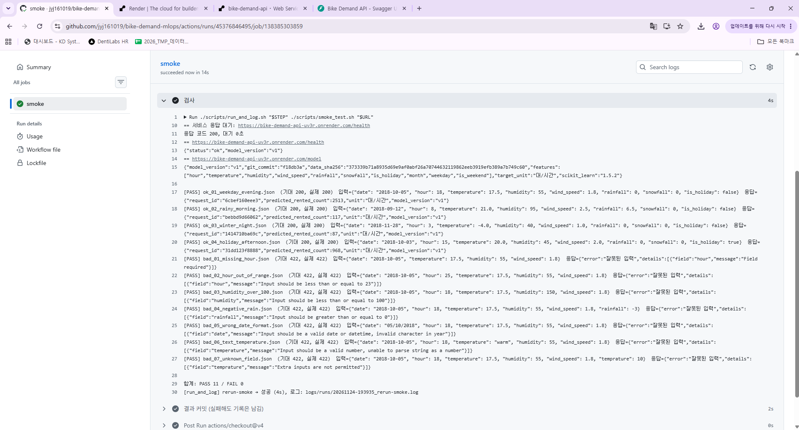
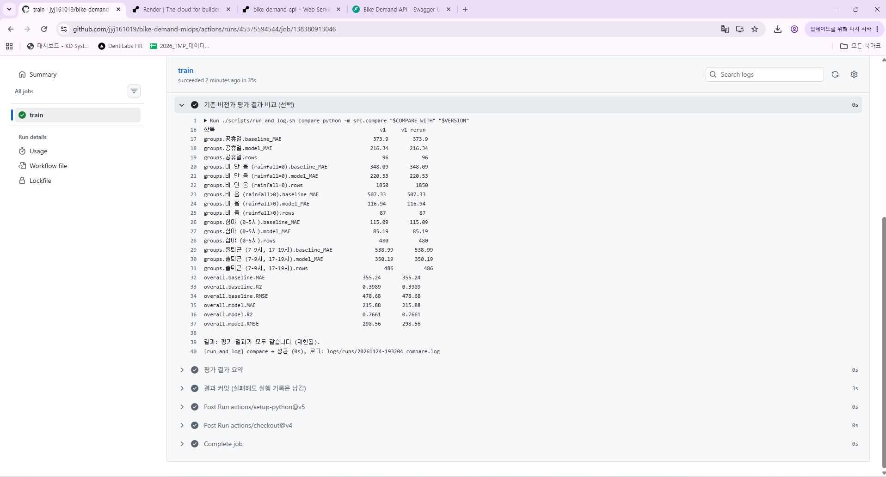
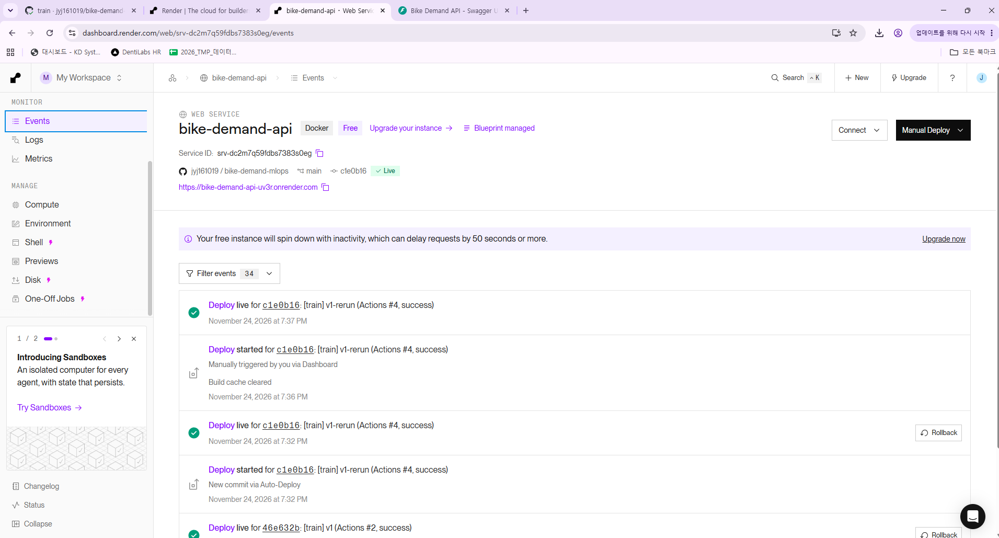

# 3. 결과 평가

## 판단 기준

- 운영 담당자가 쓰려면 **기준 방법(시간대×주말 평균)보다 오차가 확실히 작아야** 의미가 있습니다.
- 지표: MAE (평균 절대 오차, 대/시간), RMSE (큰 오차에 더 민감, 대/시간), R2 (설명력, 단위 없음)
- 평가 자료: 2018-09-01 ~ 2018-11-30, 학습에 쓰지 않은 기간 전체
- 계산: `src/train.py` 5) 평가 부분

## 결과 (v1, Actions train #2)

평가 자료: 2018-09-01 ~ 2018-11-30, 1,937건 / 학습 자료: 2017-12-01 ~ 2018-08-31, 6,528건
원본: [models/v1/evaluation.md](../models/v1/evaluation.md), [metrics.json](../models/v1/metrics.json), [test_predictions.csv](../models/v1/test_predictions.csv)

| 방법 | MAE (대/시간) | RMSE (대/시간) | R2 |
|---|---|---|---|
| 기준(시간대×주말 평균) | 355.24 | 478.68 | 0.3989 |
| 모델 | 215.88 | 298.56 | 0.7661 |

조건별 MAE (대/시간):

| 조건 | 건수 | 기준 MAE | 모델 MAE | 감소율 |
|---|---|---|---|---|
| 비 안 옴 | 1,850 | 348.09 | 220.53 | 36.6% |
| 비 옴 | 87 | 507.33 | 116.94 | 77.0% |
| 출퇴근 (7-9시, 17-19시) | 486 | 538.99 | 350.19 | 35.0% |
| 심야 (0-5시) | 480 | 115.09 | 85.19 | 26.0% |
| 공휴일 | 96 | 373.90 | 216.34 | 42.1% |

오차가 가장 큰 10건은 [models/v1/evaluation.md](../models/v1/evaluation.md) 에 있습니다.

### 해석

**1. 기준 방법보다 오차가 확실히 작다.**
MAE가 355.24 → 215.88대로 39.2% 줄었고, RMSE도 37.6% 줄었다. R2는 0.40 → 0.77로, 시간대·주말만으로는 설명하지 못하던 변화를 날씨와 월 정보로 상당 부분 설명한다. 목적(재배치 계획)에 쓸 최소 조건인 "평균값보다 낫다"는 충족한다.

**2. 날씨 영향이 큰 시간에서 차이가 가장 크다.**
비 오는 시간에는 기준 방법이 평소 평균을 그대로 내놓아 MAE가 507대였지만, 모델은 비로 수요가 줄어드는 것을 반영해 117대로 77% 줄었다. 날씨를 입력으로 받는 이유가 가장 잘 드러나는 결과다.

**3. 출퇴근 시간 오차가 가장 크다.**
출퇴근 시간 모델 MAE는 350대로 심야(85대)의 4배다. 대여량 자체가 많은 시간이라 절대 오차도 커진다. 재배치 판단에 가장 중요한 시간이므로 이 시간대 오차를 줄이는 것이 다음 개선 대상이다.

**4. 오차가 가장 큰 10건은 모두 "10~11월 평일 오전 8시, 기온 3~9°C, 비 없음"이다.**
실제 1,900~2,200대인데 모델은 550~900대로 예측해, 모두 1,100대 이상 **적게** 예측했다.
원인으로 판단한 점:
- 학습 기간(12월~8월)에서 기온 3~9°C인 시간은 대부분 겨울·초봄이라 대여량이 적었다. 모델이 "이 기온 = 수요 적음"으로 배웠다.
- 같은 기온이라도 가을 출근 시간에는 수요가 훨씬 많지만, 학습 자료에 9~11월이 없어 이 패턴을 배울 수 없었다.
- 2018년 동안 이용량 자체가 늘어난 추세도 반영되지 않았다.

즉 평가 기간이 학습에 없던 계절이라 생긴 한계이며, 실제 서비스에서는 최소 1년 이상의 자료로 모든 계절을 학습해야 한다.

## 서비스 동작 검사

GitHub Actions `smoke` 워크플로가 `scripts/smoke_test.sh` 로 Render에 배포된 서비스(https://bike-demand-api-uv3r.onrender.com)에 직접 요청을 보내 확인했습니다.

| 종류 | 입력 파일 | 기대 | 결과 (smoke #1, #2) |
|---|---|---|---|
| 정상: 평일 저녁 (10/5 18시, 17.5°C, 맑음) | `ok_01_weekday_evening.json` | 200 | 200, 2,513대 |
| 정상: 비 오는 출근 시간 (9/12 8시, 강수 6.5mm) | `ok_02_rainy_morning.json` | 200 | 200, 117대 |
| 정상: 겨울 새벽 (11/28 3시, -4°C) | `ok_03_winter_night.json` | 200 | 200, 87대 |
| 정상: 공휴일 오후 (10/3 15시) | `ok_04_holiday_afternoon.json` | 200 | 200, 968대 |
| 필수값 누락 (hour 없음) | `bad_01_missing_hour.json` | 422 | 422, `hour: Field required` |
| 범위 밖 (hour=25) | `bad_02_hour_out_of_range.json` | 422 | 422, `less than or equal to 23` |
| 범위 밖 (습도 150) | `bad_03_humidity_over_100.json` | 422 | 422, `less than or equal to 100` |
| 음수 강수량 (-3) | `bad_04_negative_rain.json` | 422 | 422, `greater than or equal to 0` |
| 날짜 형식 오류 (05/10/2018) | `bad_05_wrong_date_format.json` | 422 | 422, `valid date` |
| 숫자 자리에 문자 ("warm") | `bad_06_text_temperature.json` | 422 | 422, `valid number` |
| 모르는 필드 (temprature 오타) | `bad_07_unknown_field.json` | 422 | 422, `Extra inputs are not permitted` |

결과: smoke #1, smoke #2(재배포 후) 모두 **PASS 11 / FAIL 0**. 전체 출력은 [logs/run_log.md](../logs/run_log.md) 의 smoke, rerun-smoke 줄에 연결된 로그 파일에 있습니다.

정상 입력의 예측값도 상식과 맞는지 확인했습니다. 맑은 평일 퇴근 시간(2,513대)이 가장 많고, 같은 계절이라도 비 오는 출근 시간(117대)과 겨울 새벽(87대)은 크게 적습니다.

## 재실행 확인

| 확인 | 방법 | 결과 |
|---|---|---|
| 학습 재현 | 새 Actions 러너에서 같은 코드·데이터로 다시 학습 (train #4, `v1-rerun`) | 전체·조건별·오차 상위 10건까지 v1 과 모두 같음 (MAE 215.88, RMSE 298.56, R2 0.7661) |
| 서비스 재구축 | Render 빌드 캐시를 지우고 처음부터 다시 빌드·배포 | Live, `/health` 정상, 모델 v1 |
| 재배포 후 검사 | Actions smoke #2 (`rerun-smoke`) | PASS 11 / FAIL 0, 같은 입력에 같은 예측값(2,513대) |

## 한계

- 데이터가 2017~2018년 1년치라 최근 수요 변화(대여소 증가 등)를 반영하지 못함
- 학습 자료에 가을(9~11월)이 없어, 가을 평일 출근 시간 수요를 크게 낮게 예측함 (오차 상위 10건 모두 해당)
- 입력하는 날씨가 **실제 관측값**으로 학습됐으므로, 실제 사용 시 넣는 **예보값**의 오차는 반영되지 않음
- 공휴일 여부는 사용자가 직접 넣어야 함
- 대여소별이 아니라 서울 전체 합계만 예측
- 무료 인스턴스라 15분간 요청이 없으면 꺼지고, 다음 첫 요청은 50초 이상 걸릴 수 있음
- 평가 기간이 가을(9~11월)뿐이라 여름·겨울 성능은 따로 확인하지 못함
- 입력 범위를 벗어나는 값은 거절하지만, 범위 안의 드문 조합(예: 한여름 폭설)은 검사하지 못함
