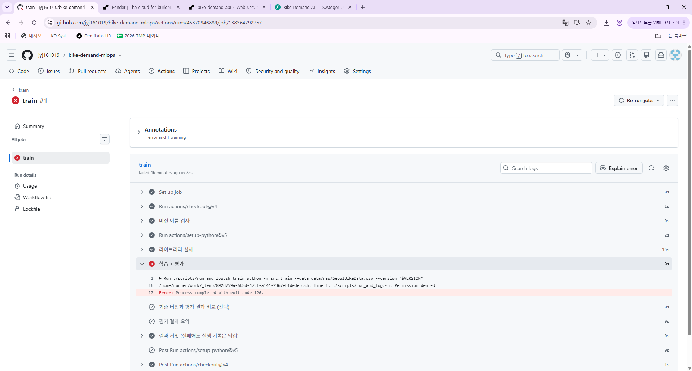
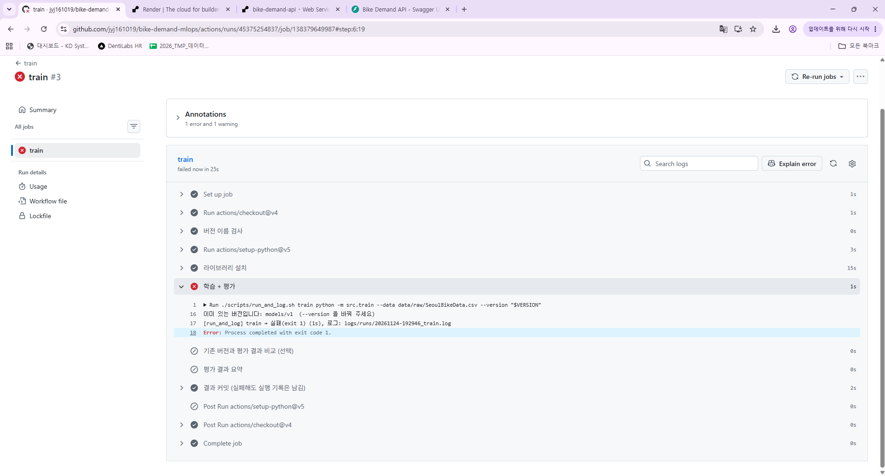

# 4. 오류 조사와 복구

클라우드에서 실제로 겪은 오류와 복구 과정입니다. 모든 실행은 [GitHub Actions 실행 목록](https://github.com/jyj161019/bike-demand-mlops/actions)에 실패·성공 순서대로 남아 있고, 기록 스크립트가 동작한 실행은 [logs/run_log.md](../logs/run_log.md) 에도 있습니다.

| 순서 | 실행 | 결과 | 내용 |
|---|---|---|---|
| 1 | train #1 | 실패 | 오류 1 발생 (스크립트 실행 권한 없음) |
| 2 | train #2 | 성공 | 오류 1 수정 후 v1 학습 |
| 3 | train #3 | 실패 (의도한 거절) | 오류 2 재현 (이미 있는 버전으로 학습) |
| 4 | train #4 | 성공 | 새 버전 이름(v1-rerun)으로 재실행 |

## 오류 1: Actions 에서 학습 스크립트 실행 권한 없음 (exit code 126)

| 항목 | 내용 |
|---|---|
| 발생 시각 | 2026-11-24, train #1 (첫 클라우드 학습) |
| 단계 / 실행 위치 | GitHub Actions train #1 → "학습 + 평가" 단계 |
| 오류 메시지 | `./scripts/run_and_log.sh: Permission denied` / `Process completed with exit code 126.` |
| 영향 | 학습이 시작되지 못해 모델이 만들어지지 않음. 이후 단계(평가 요약)는 건너뜀 |
| 원인 | Windows 에서 커밋해 `.sh` 파일에 실행 권한이 없는 상태(파일 모드 `100644`)로 저장소에 올라감. Linux 러너는 실행 권한이 없는 파일을 `./` 로 실행할 수 없음 |
| 원인 확인 방법 | ① 실패 단계 로그의 `Permission denied`, exit code 126(실행 권한 없음) ② 최초 `git commit` 출력에서 `create mode 100644 scripts/run_and_log.sh` 확인 (실행 파일이면 `100755`) |
| 수정 내용 | `git update-index --chmod=+x scripts/run_and_log.sh scripts/smoke_test.sh` 로 Git 에 실행 권한 기록 후 커밋·푸시 (커밋 `f18db3a`) |
| 재실행 결과 | 같은 워크플로, 같은 입력(version `v1`)으로 새로 실행(train #2) → 성공, `models/v1` 생성 |
| 기록 | 실패: Actions train #1, 아래 캡처 (기록 스크립트 자체가 실행되지 못해 run_log.md 에는 없음) / 성공: Actions train #2, run_log.md |
| 재발 방지 | `.gitattributes` 로 `.sh` 줄바꿈은 LF 로 고정되어 있음. 새 스크립트를 추가할 때도 `--chmod=+x` 로 커밋 |

## 오류 2: 이미 있는 모델 버전으로 학습 요청 (덮어쓰기 방지 확인)

| 항목 | 내용 |
|---|---|
| 발생 시각 | 2026-11-24, train #3 |
| 단계 / 실행 위치 | GitHub Actions train #3 → "학습 + 평가" 단계 |
| 입력 | version `v1` (train #2 에서 이미 만든 버전) |
| 오류 메시지 | `이미 있는 버전입니다: models/v1  (--version 을 바꿔 주세요)` / exit 1 |
| 영향 | 학습이 실행되지 않음. **서비스 중인 v1 모델과 평가 결과는 그대로 유지됨** |
| 원인 | 같은 이름으로 다시 학습하면 서비스 중인 모델 파일이 바뀌어, 어떤 모델로 서비스했는지 추적할 수 없게 됨. 이를 막기 위해 `src/train.py` 가 기존 버전 폴더가 있으면 거절하도록 구현함 |
| 원인 확인 방법 | 단계 로그의 거절 메시지, 저장소 `models/v1/metadata.json` 의 `created_at_utc` 가 train #2 시각 그대로인지 확인 |
| 수정 내용 | 코드 수정 없음 (의도한 동작). 새 버전 이름으로 다시 실행 |
| 재실행 결과 | version `v1-rerun` 으로 실행(train #4) → 성공, 평가 결과가 v1 과 완전히 같음 ([03_evaluation.md](03_evaluation.md) 재실행 확인) |
| 기록 | 실패: Actions train #3, run_log.md 의 `train / 실패(exit 1) / v1` 줄 / 성공: Actions train #4 |

